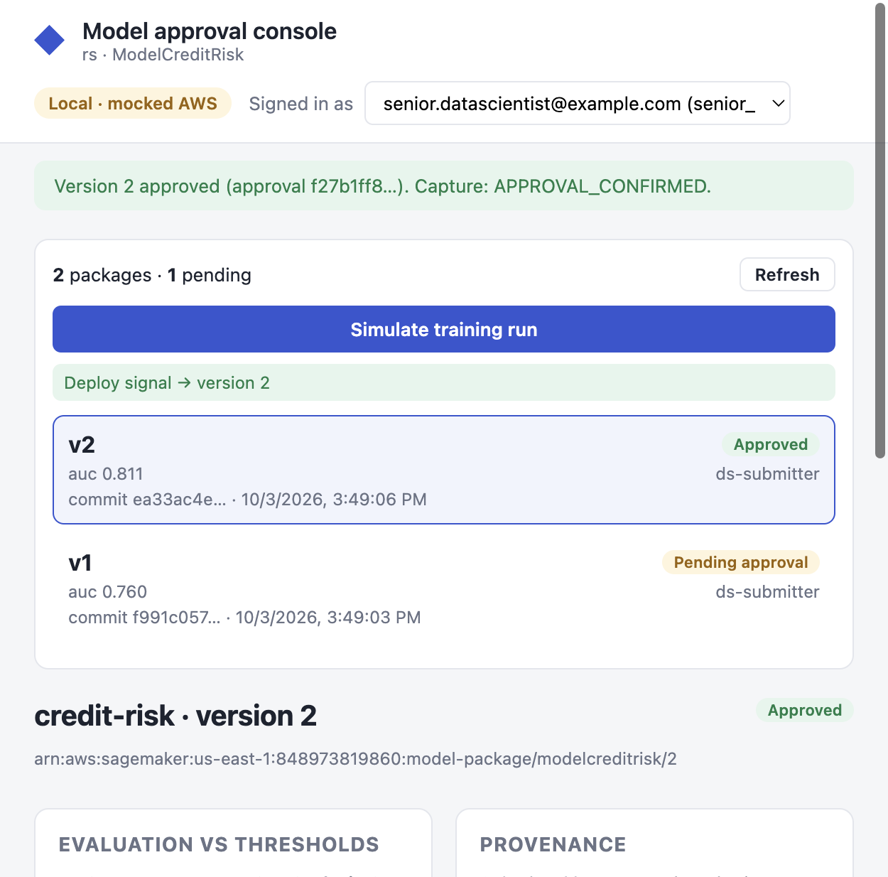

# credit-risk POC

A small model repository that exercises the ML Platform v7 lifecycle end to end with a
credit-risk classifier trained on synthetic data. The platform code (`ml_platform`, Lambdas,
Terraform) lives in [ML-Platform](https://github.com/Debashis2007/ML-Platform); this repo holds
the model, its configuration, the build and deploy workflows, and the endpoint Terraform.

> **POC deviation:** training runs in the control plane NonProd account
> (`aws.training_target: control_plane`). The v7 target state trains in the BU account; only the
> `aws` block in `model.yaml` changes.

## Layout

| Path | Purpose |
|------|---------|
| `model.yaml` | Model configuration: accounts, data, thresholds, registry group, deployment targets, approvers |
| `train.py` / `evaluate.py` | Training and evaluation scripts run by the SageMaker pipeline |
| `preprocess.py` | Optional prepare step (`steps.prepare.enabled`) |
| `inference.py` / `Dockerfile` | Serving image, pushed to ECR and pinned by digest |
| `scripts/make_synthetic_data.py` | Synthetic numeric dataset with a `default` target |
| `tests/` | Local smoke test: data, train, evaluate, threshold gate, `model.yaml` validation |
| `.github/workflows/ml-lifecycle.yml` | Model build: test on every PR; build image and start the pipeline on `main` |
| `.github/workflows/model-deploy.yml` | Model deploy: staging, test on staging, manual approval, Prod (started by an approval) |
| `.github/workflows/release-endpoint.yml` | Reusable Terraform release of one endpoint, used by `model-deploy.yml` |
| `infra/bootstrap/` | One-time AWS setup: GitHub OIDC provider, Terraform state bucket, deploy role |
| `infra/endpoint/` | Endpoint Terraform: model, endpoint config, blue/green endpoint, rollback alarms |
| `infra/deploy-trigger/` | EventBridge rule and Lambda that start `model-deploy.yml` when a package is approved |
| `scripts/endpoint_check.py` | Post-deploy check: served revision and test predictions |
| `scripts/local_e2e.py` | Full lifecycle against mocked AWS |
| `ui/` | Lifecycle console (pipeline and approvals): React frontend (`ui/frontend`), FastAPI backend (`ui/backend`) |

## Run locally

```bash
python3 -m venv .venv && source .venv/bin/activate
git clone --branch feature/v7-alignment https://github.com/Debashis2007/ML-Platform.git .platform
pip install -r .platform/requirements.txt -r requirements.txt -r requirements-dev.txt
export PYTHONPATH=$PWD/.platform

python -m pytest tests/ -q                                  # all tests, including mocked-AWS lifecycle
python -m ml_platform.build_pipeline --config model.yaml    # pipeline definition, no AWS calls
python scripts/local_e2e.py                                 # full v7 lifecycle against mocked AWS
```

### Full lifecycle against mocked AWS

`scripts/local_e2e.py` runs the v7 flow end to end with [moto](https://github.com/getmoto/moto)
mocking S3, DynamoDB, SageMaker (pipeline execution and model registry), ECR, SSM and
EventBridge. Fake credentials are forced, so it never touches a real account.

| Stage | Real code | Mocked |
|-------|-----------|--------|
| Image push | — | ECR repository and digest |
| Pipeline | The platform's pipeline definition (`build_steps`); `train.py`, `evaluate.py`, threshold gate, platform `publish_candidate.py` run locally | SageMaker pipeline execution and parameters, S3 staging |
| Registration | Platform `register_candidate` Lambda (checksum copy-in, evidence, `PendingManualApproval`) | S3, DynamoDB, model registry |
| Approval | Platform `approval_api` Lambda: self-approval refused (403), wrong hash refused (409), senior DS approval (200) | Okta claims passed as authorizer context |
| Capture | Platform `capture_approval_event` Lambda: API approval confirmed and deploy parameter set; console approval flagged as violation | SSM, EventBridge |

Promotion to Prod and endpoint releases are not part of the local run.

## Lifecycle console (React + FastAPI)



A web console with two tabs. Approval rules are enforced by the platform's management API, never
by the console.

- **Approvals:** senior data scientists review candidates and approve or reject them.
- **Pipeline:** the training pipeline as the platform defines it (Train, Evaluate, CheckMetric,
  then PublishCandidate when the gate is True), with the CI steps before it and registration,
  registry status and the deploy signal after it. Pick an execution to see each step's status,
  duration, outputs and the execution parameters; click a step for its definition (image,
  instance, entrypoint, conditions). **Start run** trains a new candidate; **Start run on
  shuffled labels** trains on labels with no signal, so the gate fails and nothing is
  registered. Each package's provenance links to the run that produced it.
  **Where it stands** highlights the flow's current position: the step running now (live, with
  progress), the registry while a candidate waits for approval, the deploy signal once approved,
  or the step where a run stopped. Local steps are paced (`MLP_CONSOLE_STEP_PACE_S`, default
  0.8 s) so a run can be followed; set it to `0` to run at full speed.

```bash
./ui/run_local.sh            # builds the frontend once, then serves http://127.0.0.1:8000
```

- **Local mode (default):** runs on mocked AWS. At startup one run on shuffled labels fails the
  gate, and two candidates are trained and registered (v1 by `ds-submitter`, v2 by `lead-sds`).
  Switch the signed-in user to change role:

  | User | Role | Train | Approve |
  |------|------|-------|---------|
  | `senior.datascientist@example.com` | Senior data scientist | Yes | Yes, except candidates they submitted |
  | `lead.datascientist@example.com` | Senior data scientist | Yes | Yes, except candidates they submitted (v2) |
  | `data.scientist@example.com` | Data scientist | Yes | No (role) |
  | `other.tenant.sds@example.com` | Senior data scientist, other tenant | No | No (tenant scope) |
  | `analyst@example.com` | Viewer | No | No (role) |

  The console disables actions the signed-in user isn't allowed to take and says why. **Send
  approval anyway** submits the request so you can see the management API refuse it. Approvals
  run the capture Lambda, so the deploy signal and decision log update live. **Simulate training
  run** registers a new candidate submitted by the signed-in user; **Simulate console approval**
  approves outside the API to show violation detection.
- **Remote mode:** `MLP_CONSOLE_MODE=remote MLP_API_URL=https://<api-id>-<vpce-id>.execute-api.<region>.amazonaws.com/v1 ./ui/run_local.sh`.
  Packages and pipeline executions (set `MLP_PIPELINE_NAME` to override the name from
  `model.yaml`) are listed from SageMaker with your AWS credentials (read-only), and
  decisions are sent to the private management API with the Okta access token pasted in the
  header. The API is private, so run the console from inside the VPC or over the VPN.

- **Real AWS mode** (single-account POC without the management API): `MLP_CONSOLE_MODE=aws`.
  The **Model** picker in the header lists every model in the model catalog, and all three tabs
  follow the selected one. Approvals lists that model's registry group with evaluation metrics from
  each package's `ModelMetrics`, checked against the model's thresholds. A senior data scientist who
  did not start the run approves or rejects in the SageMaker registry directly; versions below a
  threshold cannot be approved. The console does not deploy: the approval's SageMaker event
  starts the model-deploy workflow (see [Model deploy workflow](#model-deploy-workflow)).
  **Start run** starts the model's pipeline. Roles come from `CONSOLE_ROLES`
  (`user:senior_data_scientist`, `user:data_scientist`; unlisted users are viewers). Uses the
  standard `AWS_*` credentials; on the POC account the Railway key is the `credit-risk-console` IAM
  user with the `credit-risk-console` managed policy (the credit-risk group, pipeline and endpoint
  only).

#### Model catalog

To reuse the console for other model repos, see
[docs/lifecycle-console-standalone.md](docs/lifecycle-console-standalone.md): copy `ui/`, edit
`models.json`, set the environment, and build the slim `ui/Dockerfile.standalone` image.

`ui/backend/models.json` lists the models the console manages (override with `MLP_MODELS`, a JSON
array, or `MLP_MODELS_FILE`). Each entry:

| Field | Meaning |
|-------|---------|
| `id`, `name` | URL-safe id (`?model=`) and the name shown in the picker |
| `model_package_group`, `pipeline`, `endpoint` | the model's SageMaker registry group, pipeline and real-time endpoint (endpoint optional) |
| `thresholds` | `{metric: minimum}` checked before approval |
| `features` | `[{name, label, hint, step}]` in the order the model expects; the Test endpoint form |
| `presets`, `outcome` | example inputs for the form, and labels for the prediction (`positive`, `negative`, `score`) |
| `github` | optional `{repo, workflow, branch}` for the **GitHub** tab: recent GitHub Actions runs, a red badge when the newest finished run failed, the failed job and step, and the error lines from its log |

To add a model: create its pipeline (registering into its group with `ModelMetrics`) and add an
entry. The console refuses packages from other groups on a model's routes. Then extend the console's
IAM policy to that model's group, pipeline, endpoint and evaluation bucket.

Frontend development with hot reload: run the backend as above, then `cd ui/frontend && npm run dev`
(http://127.0.0.1:5173, proxies `/api` to port 8000).

### Hosting

`ui/Dockerfile` builds the console as one container; `railway.json` deploys it on Railway. A hosted
console requires a login: the image sets `CONSOLE_AUTH_REQUIRED=1` and refuses to start without
users. Configure each deployment with its own values, never shared with other projects:

| Variable | Value |
|----------|-------|
| `CONSOLE_USERS` | `username:<hash>` entries, comma-separated; hash from `python ui/backend/auth.py hash` |
| `CONSOLE_SESSION_SECRET` | from `python ui/backend/auth.py secret` |
| `CONSOLE_PROJECT` | project name, e.g. `credit-risk`; bound into the session and the cookie name |
| `CONSOLE_SESSION_HOURS` | session lifetime, default 12 |
| `RAILWAY_DOCKERFILE_PATH` | `ui/Dockerfile` (otherwise Railway may build the training image in the root `Dockerfile`) |
| `MLP_ENDPOINT_REGION` | endpoint region, default `us-east-1` |
| `MLP_ENDPOINT_AWS_ACCESS_KEY_ID` / `MLP_ENDPOINT_AWS_SECRET_ACCESS_KEY` | key for an IAM user allowed only `sagemaker:InvokeEndpoint` and `DescribeEndpoint` on the catalog's endpoints, plus `DescribeEndpointConfig` and `DescribeModel` on their configs and models |
| `MLP_MODELS` / `MLP_MODELS_FILE` | optional model catalog override (see Model catalog) |
| `MLP_GITHUB_TOKEN` | optional fine-grained GitHub token, read-only **Actions** and **Metadata** on the model repos; needed for error logs in the GitHub tab (without it, public repos still list runs, at 60 GitHub API requests an hour) |
| `CONSOLE_ROLES` | aws mode: `user:role` entries, comma-separated |

The **Test endpoint** tab calls the selected model's real endpoint in every console mode; local mode
mocks only the lifecycle. It uses its own `MLP_ENDPOINT_*` variables because local mode replaces
`AWS_*` credentials with fakes.

Sessions are signed with the deployment's secret and bound to its project, and the cookie is
host-only, so a session from one project's console is never sent to, or accepted by, another.
Failed logins are throttled (5 per 15 minutes per client). Without `CONSOLE_USERS`, as in
`./ui/run_local.sh`, the console is open.

## Lifecycle

1. **Data:** generate and upload the training set to `data.train_uri`:
   ```bash
   python scripts/make_synthetic_data.py --rows 5000 --out data/train/train.csv
   aws s3 cp data/train/train.csv s3://ml-platform-data-848973819860/credit-risk/train/train.csv
   ```
2. **Train (this repo):** a push to `main` builds the image, pins it by digest, upserts pipeline
   `demo-credit-risk` and starts it. The pipeline runs Train, Evaluate, a gate on every threshold,
   then publishes `candidate.json`.
3. **Register (platform):** on pipeline success the `register_candidate` Lambda copies the model
   and evidence into the control plane with checksum verification and creates a
   `PendingManualApproval` package in `ModelCreditRisk`.
4. **Approve:** a senior data scientist other than the submitter approves the package in the
   SageMaker Model Registry (in the POC console's aws mode, or the registry UI).
5. **Deploy (this repo):** the approval starts `model-deploy.yml`: Terraform releases the package
   to the staging endpoint, the staging endpoint is tested, an MLOps engineer approves the
   `ml-prod` environment, and Terraform releases it to the Prod endpoint as a canary.

The v7 target state adds promotion by digest and a Prod retrain before release; see the ML-Platform
`ml-lifecycle` workflow. The POC deploys the same approved package to both endpoints in one account.

## Model deploy workflow

```
Model Registry approval ──► EventBridge ──► deploy-trigger Lambda ──► repository_dispatch (model-approved)
  ──► deploy-staging (Terraform) ──► test-staging ──► manual approval (ml-prod) ──► deploy-prod (Terraform)
```

| Job | What it does |
|-----|--------------|
| `deploy-staging` | Checks the package is `Approved` in `ModelCreditRisk`, then Terraform releases it to `credit-risk-qa`, all at once, one instance |
| `test-staging` | `scripts/endpoint_check.py`: the endpoint is `InService`, serves exactly this package, and the presets score sensibly (Risky applicant above Safe applicant) |
| `deploy-prod` | Waits for the `ml-prod` environment's required reviewers, then Terraform releases it to `credit-risk-prod`: two instances, 10% canary for 15 minutes, auto-rollback on 5xx or p99 latency alarms, then the same check |

Each release names its model and endpoint config `<endpoint>-v<package version>`, so rerunning a
release for the same package changes nothing. Terraform state is per environment
(`credit-risk/endpoint-staging.tfstate`, `credit-risk/endpoint-prod.tfstate`) in
`MLP_TF_STATE_BUCKET`, locked with S3 native locking. An endpoint created before Terraform
managed it (the console's old direct deploy created `credit-risk-qa`) is imported on the first run.

To redeploy by hand: **Actions → Model deploy → Run workflow** with the package ARN.

### One-time setup

0. **Bootstrap** (GitHub OIDC provider, state bucket, deploy role), applied by hand:
   ```bash
   cd infra/bootstrap
   terraform init && terraform apply \
     -var serving_role_arn="$(aws sagemaker describe-pipeline --pipeline-name credit-risk --query RoleArn --output text)"
   # If the account already has a GitHub OIDC provider, add -var github_oidc_provider_arn=<its ARN>.
   gh secret set MLP_GHA_DEPLOY_ROLE_ARN --env ml-staging --body "$(terraform output -raw deploy_role_arn)"
   gh secret set MLP_GHA_DEPLOY_ROLE_ARN --env ml-prod --body "$(terraform output -raw deploy_role_arn)"
   gh variable set MLP_TF_STATE_BUCKET --body "$(terraform output -raw state_bucket)"
   ```
1. **Deploy trigger** (EventBridge rule, Lambda, Secrets Manager secret), with ML-Platform checked
   out at `.platform`:
   ```bash
   cd infra/deploy-trigger
   terraform init && terraform apply
   aws secretsmanager put-secret-value --secret-id "$(terraform output -raw github_token_secret_arn)" \
     --secret-string '<fine-grained token: Contents read and write on credit-risk-poc>'
   ```
2. **GitHub environments:** `ml-staging` (no reviewers) and `ml-prod` with **Required reviewers**
   set to the MLOps engineers. Prevent self-review so the person who approved the model in the
   registry cannot also release it to Prod.
3. **Deploy role** (created by the bootstrap): trusted only for
   `repo:Debashis2007/credit-risk-poc:environment:ml-staging` and `...:environment:ml-prod`, and
   allowed only to: describe the model's packages and pipeline; create, describe and delete its
   models and endpoint configs; create, update, describe and invoke the two endpoints; tag them;
   pass the serving role to SageMaker; manage the two endpoints' rollback alarms; and read and
   write `credit-risk/*` in the state bucket.

## GitHub setup

| Kind | Name | Value |
|------|------|-------|
| Environment | `ml-nonprod` | Add required reviewers if training should be gated |
| Secret (`ml-nonprod`) | `MLP_GHA_PIPELINE_ROLE_ARN` | OIDC role in the control plane NonProd account (client-managed) |
| Variable | `AWS_REGION` | `us-east-1` |
| Variable | `MLP_ARTIFACTS_BUCKET` | Control plane artifacts bucket for pipeline staging output |
| Variable | `MLP_TRAIN_ENABLED` | `true` to run the train job on pushes to `main`; leave unset until the secret and bucket above exist (tests still run on every push and PR) |
| Variable (optional) | `MLP_PLATFORM_REF` | Platform branch or tag; defaults to `feature/v7-alignment` |
| Variable (optional) | `MLP_MODEL_REPOSITORY_PREFIX` | ECR prefix; defaults to `ml-models` |
| Environments | `ml-staging`, `ml-prod` | Model deploy; `ml-prod` has the MLOps engineers as required reviewers |
| Secret (`ml-staging`, `ml-prod`) | `MLP_GHA_DEPLOY_ROLE_ARN` | OIDC deploy role (see [One-time setup](#one-time-setup)) |
| Variable | `MLP_TF_STATE_BUCKET` | S3 bucket for the endpoint Terraform state |
| Variable (optional) | `MLP_STAGING_ENDPOINT` / `MLP_PROD_ENDPOINT` | Endpoint names; default `credit-risk-qa` and `credit-risk-prod` |
| Variable (optional) | `MLP_INFERENCE_ROLE_ARN` | Serving role; defaults to the pipeline's execution role |
| Variable (optional) | `MLP_DATA_CAPTURE_S3_URI` | s3:// prefix for request and response capture; unset disables capture |

The OIDC role trust policy must allow `repo:Debashis2007/credit-risk-poc:environment:ml-nonprod`.
IAM roles are client-managed; see `docs/CLIENT_MANAGED_IAM_ROLES.md` in ML-Platform.
